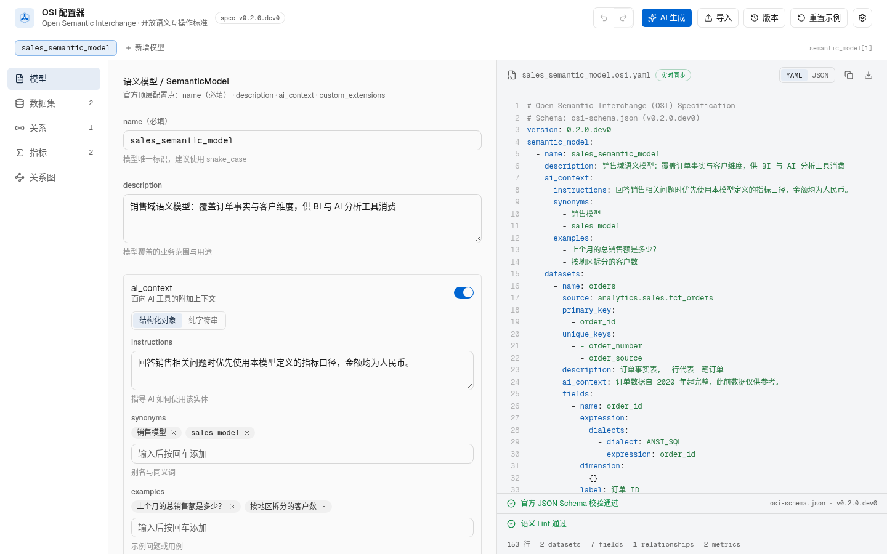
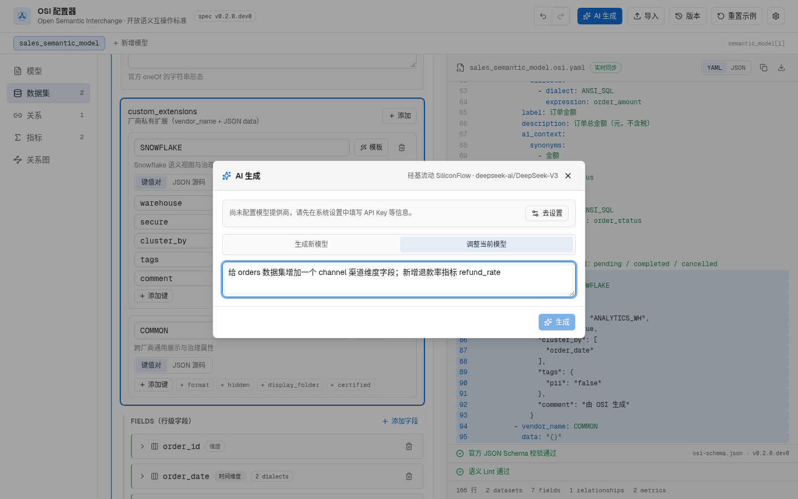
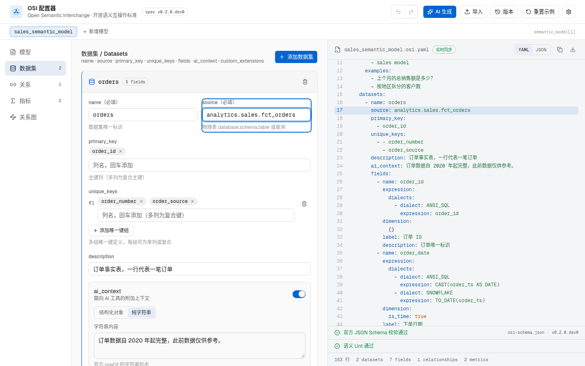
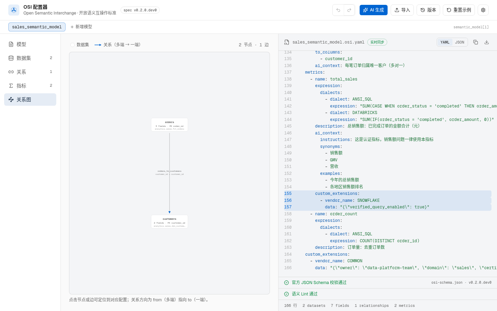
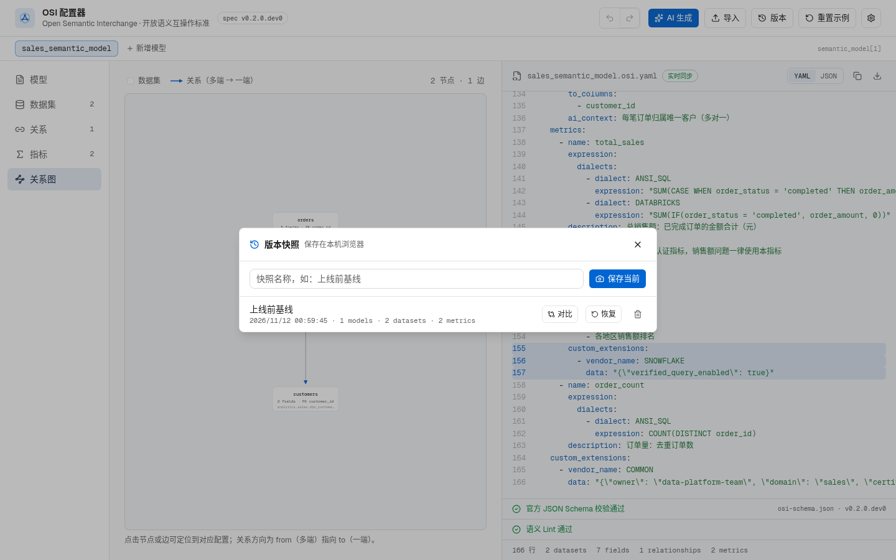
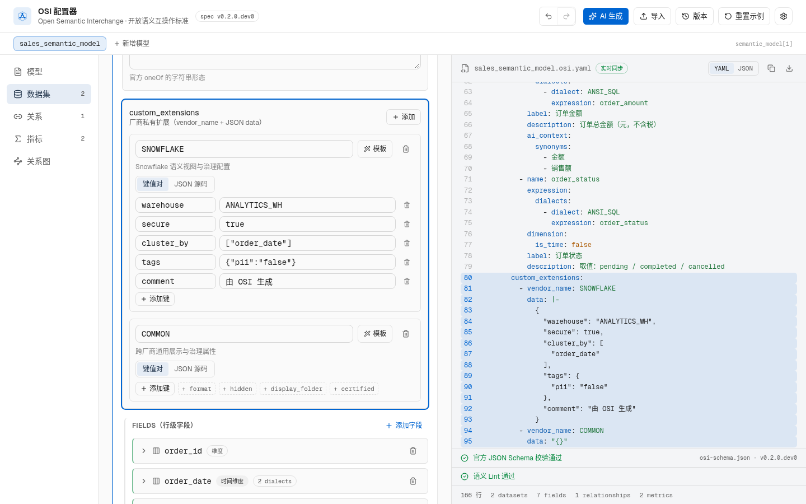
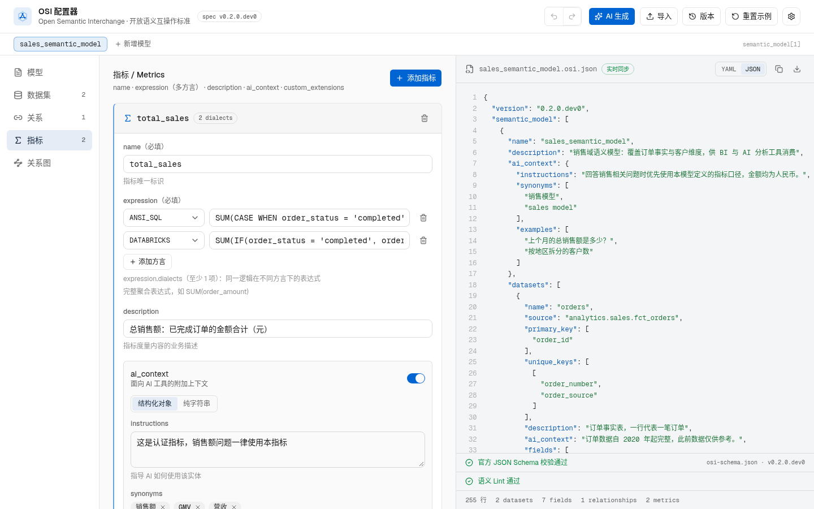

# OSI Visual Configurator

[简体中文](README.md) · **English**

A visual configurator for the Open Semantic Interchange (OSI) standard: configure a semantic model with forms on the left and get a live YAML / JSON spec on the right that conforms to the official JSON Schema (v0.2.0.dev0). Use it to define a unified semantic layer (datasets, dimensions, metrics, relationships and AI context) for BI and AI analytics tools.

> Detailed docs (Chinese) are in the [Wiki](docs/wiki/Home.md): [Getting started](docs/wiki/快速上手.md) · [OSI spec alignment](docs/wiki/OSI-规范对齐.md) · [AI generation & partial edits](docs/wiki/AI-生成与局部调整.md) · [Feature guide](docs/wiki/功能指南.md)
>
> The app UI is in Chinese; the screenshots below are from the real app.



## Features

### 1:1 coverage of every official OSI configuration point

Strictly aligned with `osi-schema.json` from the official [open-semantic-interchange/OSI](https://github.com/open-semantic-interchange/OSI) repository — nothing more, nothing less:

| Object | Supported configuration points |
| --- | --- |
| SemanticModel | name / description / ai_context / datasets / relationships / metrics / custom_extensions |
| Dataset | name / source / primary_key / unique_keys (multiple composite keys) / description / ai_context / fields / custom_extensions |
| Field | name / expression (multiple dialects) / dimension tri-state (not a dimension · `{}` · is_time) / label / description / ai_context / custom_extensions |
| Relationship | name / from / to / from_columns / to_columns (composite keys) / ai_context / custom_extensions |
| Metric | name / expression (multiple dialects) / description / ai_context / custom_extensions |
| AIContext | Both official `oneOf` shapes: structured object (instructions + synonyms + examples) or plain string |
| CustomExtension | vendor_name + JSON data, attachable at any level |

### AI generation and partial edits

A built-in AI panel (any OpenAI-compatible provider):

- **Generate a new model** from a short business description
- **Adjust the current model**: the AI only outputs a list of patch operations (nine kinds such as `upsert_dataset` / `delete_field` / `upsert_metric`) that are applied locally one by one — nodes it doesn't mention are never touched, and a change summary (e.g. `fields +1 | metrics -1`) with per-operation warnings is shown before applying



### Field-level two-way highlighting

Click or focus any input on the left (e.g. a dataset's `source`) and the matching line in the YAML/JSON on the right is highlighted and scrolled into view; click any line in the spec and the app switches to the right section, expands collapsed cards and highlights the exact input.



### Official JSON Schema validation + semantic lint

- **Schema validation**: Ajv validates against the official `osi-schema.json` (draft 2020-12) in real time, listing JSON-pointer paths with explanations; click an error to jump to the form input
- **Semantic lint**: business-level rules on top of the schema — duplicate names, relationships referencing missing datasets/columns, self-referencing relationships, snake_case naming, description and ai_context coverage, metrics missing an ANSI_SQL dialect and more — shown as error / warning / suggestion, click to locate

### Ontology graph

The "Graph" section shows dataset nodes and relationship edges (many side `from` → one side `to`, with column mappings); clicking a node or edge locates it in the spec.



### Undo/redo + local autosave + version snapshots

- **Undo/redo**: Ctrl+Z / Ctrl+Shift+Z (consecutive typing is merged into one step, up to 60 steps)
- **Autosave**: edits are persisted in the local browser and fully restored after a reload
- **Snapshots**: save named versions, restore them (restoring is undoable) and compare entity-level diffs



### Vendor extensions (custom_extensions)

OSI is an open standard and vendors differ — vendor-specific settings go into the official `custom_extensions`:

- Built-in key presets (with descriptions and sample values) for COMMON / SNOWFLAKE / DBT / DATABRICKS / GOODDATA / SALESFORCE, plus any custom vendor
- For known vendors a "template" inserts all common keys at once; unused keys can be added from quick chips
- Key-value or raw JSON editing; data is always stored as a JSON string, as the spec requires



### Multi-dialect expressions and YAML / JSON output

Metric and field expressions can be defined per SQL dialect (ANSI_SQL, SNOWFLAKE, DATABRICKS, TABLEAU, MDX, MAQL); the preview toggles between YAML and JSON with syntax highlighting and line numbers.



### Import / export

- **Import**: the "Import" button in the top bar accepts `.yaml` / `.yml` / `.json` / `.osi` spec files and parses them back into the forms (the inverse of export, lossless round-trip); invalid dialect values are normalized to the official enum
- **Export**: copy / download buttons in the preview produce `<model-name>.osi.yaml` or `.osi.json`

## Desktop downloads (Windows / macOS / Linux)

Download the installer for your platform from [Releases](https://github.com/gatesenman/osi-configurator/releases):

| Platform | File | Notes |
| --- | --- | --- |
| Windows | `OSI.Configurator.Setup.x.x.x.exe` | NSIS installer |
| macOS | `OSI.Configurator-x.x.x-universal.dmg` | Universal (Intel / Apple Silicon) |
| Linux | `OSI.Configurator-x.x.x.AppImage` | Portable, `chmod +x` and run |

> Installers are not code-signed: on Windows click "Run anyway" in SmartScreen on first launch; on macOS right-click → "Open" the first time (or allow it in System Settings → Privacy & Security).

Pushing a `v*` tag (e.g. `v0.2.0`) makes GitHub Actions build all three platforms in a matrix and publish a new Release.

## Local development

Requirements (Windows / macOS / Linux): Node.js >= 20, pnpm 10 (`npm install -g pnpm` or `corepack enable`).

```bash
# Install dependencies
pnpm install

# Start the dev server (http://localhost:3000)
pnpm dev

# Build the web version (static export to out/)
pnpm build

# Build the desktop installer for the current platform (output in dist/)
pnpm desktop:build
```

> macOS installers can only be built on a Mac and Windows installers are best built on Windows — the three platform installers are built by the GitHub Actions matrix.

## Cross-platform notes

- All npm scripts use only the Next.js / Electron CLIs with no shell-specific syntax, so they work on all three platforms
- `.gitattributes` normalizes line endings to LF, so cloning / committing on Windows doesn't create CRLF diffs
- `engines` and `packageManager` in `package.json` pin Node / pnpm versions; with `corepack enable` behaviour is identical on all platforms

## Tech stack

- **Framework**: Next.js 16 (static export) + React 19 + TypeScript
- **UI**: Tailwind CSS v4 + shadcn/ui
- **Validation**: Ajv (JSON Schema draft 2020-12) + home-grown semantic lint
- **Parsing**: yaml (importing YAML specs)
- **Desktop**: Electron + electron-builder, three-platform GitHub Actions matrix build

## Project structure

```
app/                    # Next.js pages and global styles (incl. icon.svg)
components/osi/         # configurator components
  configurator.tsx      #   main frame (section navigation, undo/redo, snapshots)
  *-panel.tsx           #   form panel for each section
  spec-preview.tsx      #   spec preview (validation + lint status)
  graph-view.tsx        #   ontology graph
  snapshots-dialog.tsx  #   version snapshots and diff
  ai-panel.tsx          #   AI generate / partial edit
  shared-editors.tsx    #   shared editors (incl. vendor extensions)
  logo.tsx              #   brand mark
lib/
  osi-types.ts          # internal editor model types
  osi-schema.json       # official OSI JSON Schema (v0.2.0.dev0)
  osi-serialize.ts      # model → spec serialization (with field-level selection keys)
  osi-import.ts         # spec → model parsing (dialect normalization)
  osi-validate.ts       # Ajv validation against the official schema
  osi-lint.ts           # semantic lint rule engine
  osi-history.ts        # undo/redo + local persistence
  osi-snapshots.ts      # version snapshots and entity-level diff
  osi-patch.ts          # AI partial-edit patch operations
  osi-vendors.ts        # vendor extension presets
  osi-ai.ts             # AI providers and prompts
  osi-defaults.ts       # built-in sales-domain sample model
electron/               # Electron main process
.github/workflows/      # three-platform desktop build workflow
docs/screenshots/       # README screenshots
```

## Configuration

No backend or environment variables are needed. Everything is configured in the UI and stored in the browser's `localStorage`:

| Key | Contents |
| --- | --- |
| `osi-ai-settings` | AI provider, base URL, model and API key. Presets for SiliconFlow, DeepSeek, OpenAI, Moonshot (Kimi), Zhipu, DashScope (Qwen), OpenRouter, Groq and Ollama (local), or "Custom" for any OpenAI-compatible endpoint |
| `osi-app-settings` | Theme (system / light / dark), default preview format (YAML / JSON), linked scrolling, auto-expanding field cards |
| `osi:document` | The semantic model being edited (autosave, undo/redo) |
| `osi:snapshots` | Named version snapshots |

> The API key stays on your machine; the browser calls the selected provider directly with no relay server.

## Contributing

Issues and pull requests are welcome. Please run `pnpm lint` and `pnpm build` before submitting, and keep the 1:1 alignment with the official `osi-schema.json` (when adding a configuration point, update both `lib/osi-serialize.ts` and `lib/osi-import.ts` so import / export stays a lossless round-trip).

## License

Built on the open OSI specification; the specification itself is copyright of the [Open Semantic Interchange](https://github.com/open-semantic-interchange) project.
